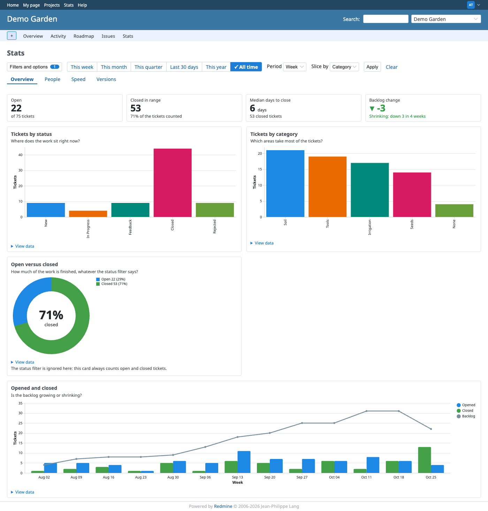
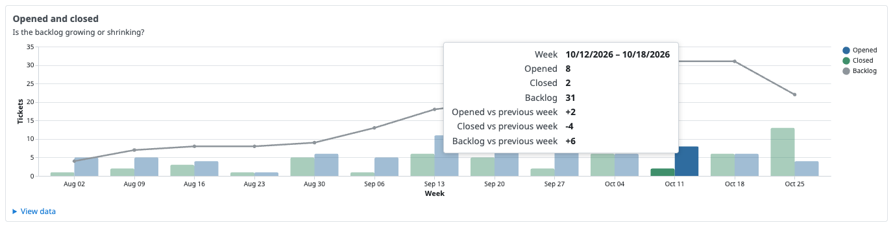
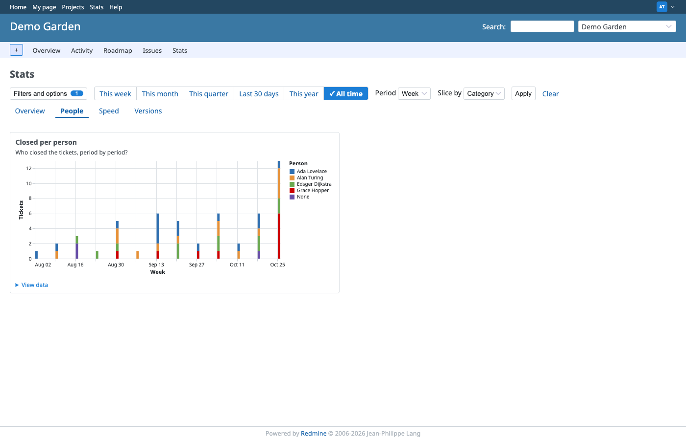
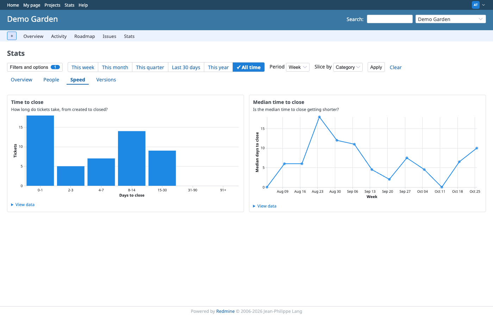
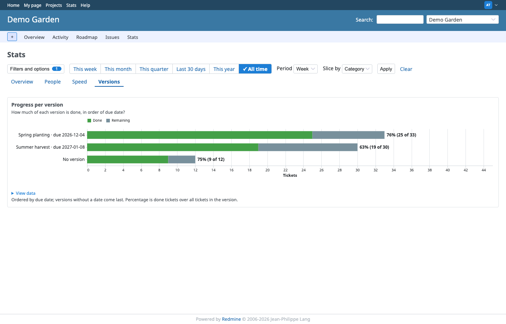
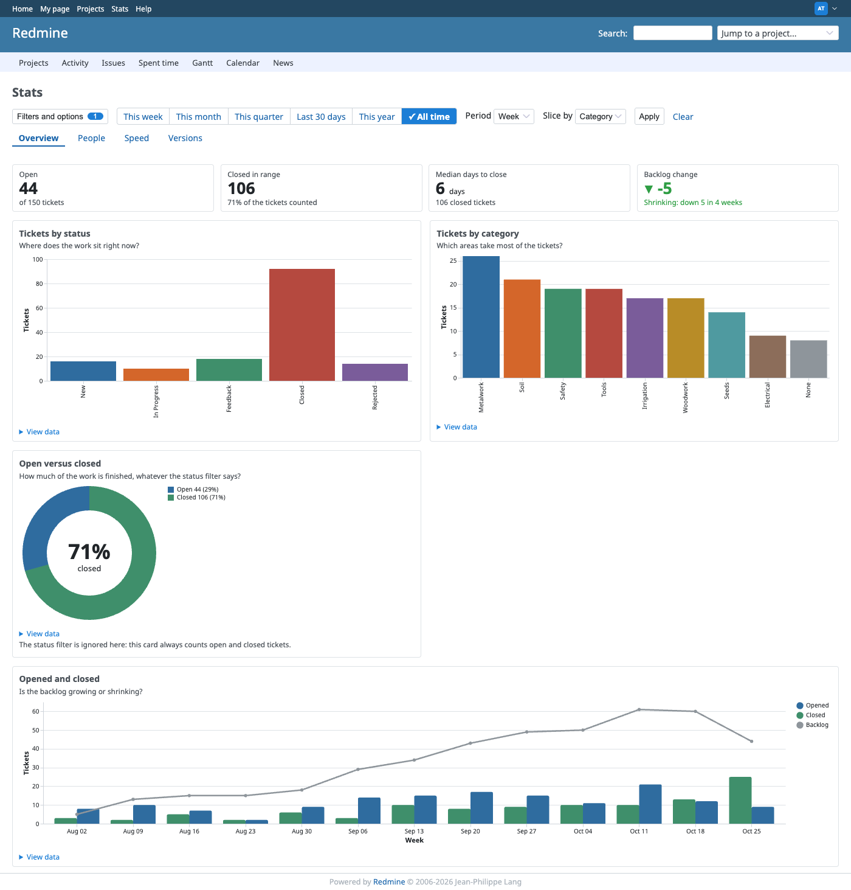

# Rubylode Stats for Redmine

TL;DR: a Stats page for every [Redmine](https://www.redmine.org) project, and one across projects, that answers "what is
getting done" with a few clear charts.

Contents:

- [What it does](#what-it-does)
- [Installation](#installation)
- [Using the charts](#using-the-charts)
- [What the tabs answer](#what-the-tabs-answer)
- [Presets and filters](#presets-and-filters)
- [The page across projects](#the-page-across-projects)
- [What's missing](#whats-missing)
- [Try it](#try-it)
- [Tests](#tests)
- [License](#license)
- [Disclaimer](#disclaimer)

I wanted a page that answers "what is getting done" in a few seconds: who closed tickets this week, which categories and
versions are being worked on, how many tickets are open and closed, how long closing takes. Redmine has the tickets but
no quick way to see that. So each project now gets a Stats page, with charts over the same filters the ticket list
already has. Point at a bar for the exact figures, click it for the matching tickets.

## What it does

- Four tabs, each one answering one family of questions: Overview, People, Speed and Versions. The charts sit in cards
  on a grid, under a filter bar.
- Redmine's own ticket filters narrow every chart, and a saved query works as a report. Every chart counts what the
  ticket list shows for the same filters.
- One row of presets (This week, This month, This quarter, Last 30 days, This year, All time) sets the dates.
- Two selects choose how to slice the data (category, version, assignee, tracker, priority, author) and how long a
  period is (day, week, month).
- Point at a mark and a tooltip gives its exact figures: the count, the share of the total, the change on the previous
  period. The other marks dim a little. A click on a legend entry hides a series.
- Click a bar, a point or a slice and the ticket list opens with the same filters plus that mark's value, in the same tab,
  or in a new one with ctrl or cmd. See [Using the charts](#using-the-charts).
- Every chart has a "View data" table with the same figures, so the page works without a mouse.
- Tickets without a value (no category, no assignee) show as "None" and are not dropped.
- Only tickets the user may see are counted.
- The charts are drawn in the browser by [Vega-Lite](https://vega.github.io/vega-lite/), which ships inside the plugin.
  No extra gem, no table, no settings page.

## Installation

Redmine 7.0 or newer, on any database Redmine supports. The plugin adds no table. The folder must be named
`redmine_rubylode_stats`, the same as the plugin id.

1. Put the plugin in your Redmine's `plugins` folder:

       cd /path/to/redmine/plugins
       git clone https://github.com/rubylode/redmine-rubylode-stats.git redmine_rubylode_stats

   Or unpack a [release archive](https://github.com/rubylode/redmine-rubylode-stats/releases) there, as `redmine_rubylode_stats`.

2. There is no migration to run. Restart Redmine, whatever serves it.

3. Allow it, as an administrator:
   1. Administration, Roles and permissions: tick View stats for the roles that should see the page.
   2. Each project needs the module once (Settings, Modules, Stats). To do all of them at once:

          bundle exec rails runner -e production 'Project.find_each { |project| project.enable_module!(:rubylode_stats) }'

4. Open a project. A Stats tab now sits after Issues, and a Stats link in the top menu opens the page across projects.

With [Docker](https://www.docker.com), mount or copy the plugin to `/usr/src/redmine/plugins/redmine_rubylode_stats`
and restart the container:

    docker compose restart redmine

To upgrade, `git pull` and restart. To remove it, delete the folder and restart. There is nothing to drop from the
database, and tickets are not touched.

## Using the charts

- Tooltip: the period or the name of the bar, each series, the total, the share of the total (status, category and
  the other slices, and open against closed), and the change on the previous day, week or month (opened and closed,
  closed per person, median days to close). Numbers and month names follow the language of the page, dates follow the
  user's date format.
- Highlight: the mark under the pointer stays bright, the others dim. On opened and closed, all the bars of the week
  stay bright together. Click a name in the legend to hide a series, click again to bring it back.
- Click-through: a bar, a point or a slice opens the ticket list with the page's own filters and the one the mark
  stands for (status, category, version, the week or month as a created or closed date range). Ctrl or cmd click
  opens it in a new tab. The address holds only filter ids and dates, and only shows for people who may open the
  ticket list. Two charts have no link, because the ticket list cannot show what they count: the time to close
  histogram, and the backlog line of opened and closed.
- Without a pointer: under each chart, "View data" opens a table with the same figures and the same links. It is a
  real table, headed and labelled, so keyboard and screen reader users reach everything. The chart carries a label
  that says what it shows.
- Theme: the tooltip takes its colours from the theme's variables. A theme can set `--stats-tooltip-background`,
  `--stats-tooltip-color`, `--stats-tooltip-key-color` and `--stats-tooltip-border`. Motion is switched off for people
  whose system asks for less of it.

## What the tabs answer

- Overview: how many tickets are open, how many were closed in the range, how long closing takes, and whether the
  backlog is growing. Four tiles come first (open tickets, closed in the range, median days to close, backlog change).
  Then tickets by status, tickets by category (or version, assignee, tracker, priority, author), a donut of open
  against closed, and opened and closed per period with the backlog line. The tiles and the donut count the same
  tickets. They ignore the status filter on purpose, so open and closed always show together.
- People: who closes tickets. It shows tickets closed per person per period. The person is the author of the change to a
  closed status. For tickets closed without such a change (an import, say) it is the assignee.
- Speed: how long closing takes. A histogram of the days from created to closed with the median marked, and the median
  per period as a line. Open tickets are left out.
- Versions: how far each version is. Done against remaining, one bar per version, in order of due date, with the share
  done and the counts at the end of the bar. Versions without a date come last, and tickets without a version show as
  "No version". Like the donut, it ignores the status filter.

A ticket that was reopened and closed again counts once, at its latest closing.

## Presets and filters

- The first time you open a tab it shows This quarter. Choose All time to see everything, which the Versions tab needs
  to show every version.
- A preset sets the date that suits the chart: closed on for finished work, created on for intake. The other filters
  stay as they were.
- Filters and options opens Redmine's usual filter form above the charts. Save a query in the ticket list and pick it
  here to use it as a report.
- The created and closed date filters set the range of the opened and closed chart. A ticket created before the range
  and closed inside it still counts.
- Weeks start on Monday, in your time zone. Subproject tickets are included when Redmine's setting for that is on.

## The page across projects

The Stats link in the top menu opens the same tabs over every project where the user holds the permission and the
module is on. Its links to the ticket list keep to those projects. The link shows only to people who have at least one.

## What's missing

- English only. The strings live in `config/locales/en.yml`; translations are welcome.
- Built so far: tickets by status, by category (or version, assignee, tracker, priority, author), open against closed,
  opened and closed per period with the backlog line, closed per person, time to close with its median, and progress
  per version.
- Planned: status over time, a calendar heatmap of closings, priority by category, cumulative flow, and CSV export per chart.
- It's built for a desktop browser.
- Tooltips need a pointer; on a touch screen the "View data" table is the way to the figures.
- A chart is tested by the data its specification carries, and the numbers behind it are tested with literal expected
  rows. The browser check (below) covers the tooltip, the highlight, the click-through and the legend.
- "Closed by" is read from the status change history, with the assignee as the fallback. A ticket that an import
  reopened and closed again, with no history, is credited to its earlier closer.

## Try it

A throwaway Redmine 7 runs from this folder, with the repository mounted as the plugin. It needs [Docker](https://www.docker.com).

    docker compose up -d
    open http://localhost:3008

Give it a minute to start. Then fill it with two demo projects (Demo Garden and Demo Workshop), four people and about 150
tickets over the last 12 weeks, some of them reopened, some without a category or an assignee:

    docker exec redmine-stats-dev bundle exec rails runner plugins/redmine_rubylode_stats/script/seed_demo.rb

Sign in as one of the demo people, with the password `demo-password-1`: `alan.turing`, `ada.lovelace`, `grace.hopper`
or `edsger.dijkstra`. The administrator is `admin` with the password `admin` (the script sets it, for this preview only).
Open Demo Garden and click Stats. The script is safe to run twice. Wipe the preview with `docker compose down -v`.

## Tests

    bin/test                                       all tests
    bin/test test/unit/issue_list_link_test.rb     one file

They run in a Redmine 7 image with its test gems. The numbers behind the charts are tested first, and a chart is checked
by the data it carries, not by how it looks. The browser parts are checked with [Playwright](https://playwright.dev) against the throwaway Redmine below, filled with
its demo data. It needs [Node](https://nodejs.org) and a Chrome or Chromium (set `CHROME_PATH` if it is not found):

    npm install
    npm run check          hover, tooltip, dimming, click-through, new tab, legend, data table, dark scheme
    npm run screenshots    retake the screenshots in docs/screenshots

By hand, in the throwaway Redmine, also open the page across projects as a user who holds the permission in one
project only.

Pull Requests are welcome!

## License

GNU General Public License, version 2 or (at your option) any later version, the same as Redmine. See `LICENSE`.

Copyright (C) 2026 Nick Gorbikoff. Each Ruby file carries the same short notice Redmine puts on its own.

## Disclaimer

Use it at your own risk. It comes with no warranty of any kind, as the license says: the software is provided "as is",
without any promise that it works, that it fits your purpose or that it's free of bugs. I'm not liable for any damage,
data loss or downtime that comes from using it, installing it or removing it.

The plugin only reads tickets. It adds no table and changes no ticket. Back up your Redmine database before you install
or upgrade anything anyway, and try it on a test instance first. I've tested it on Redmine 7.0.2, and nothing else.
