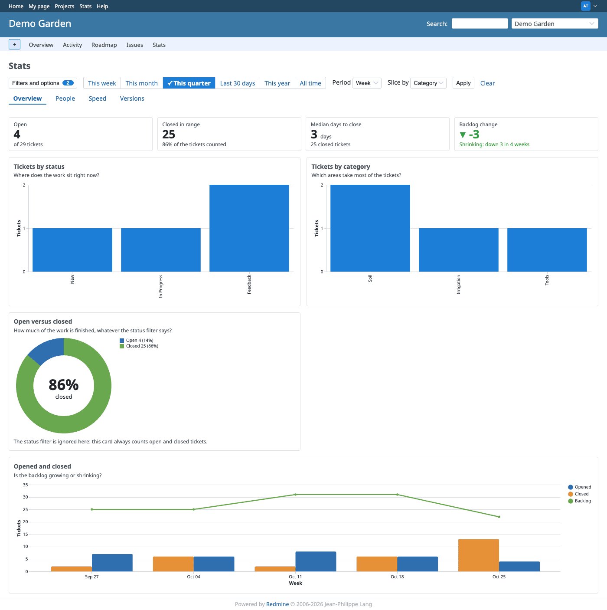
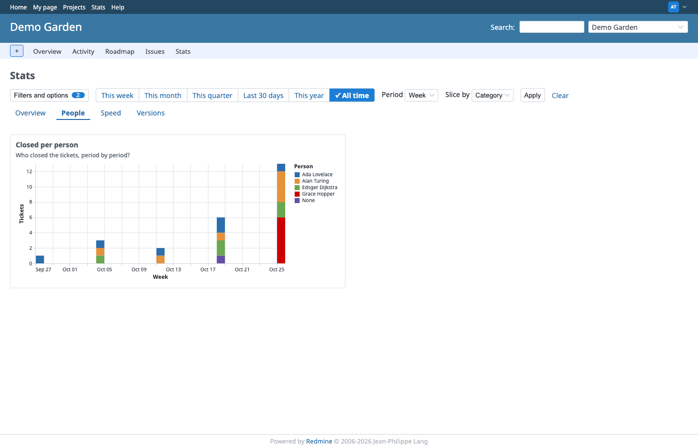
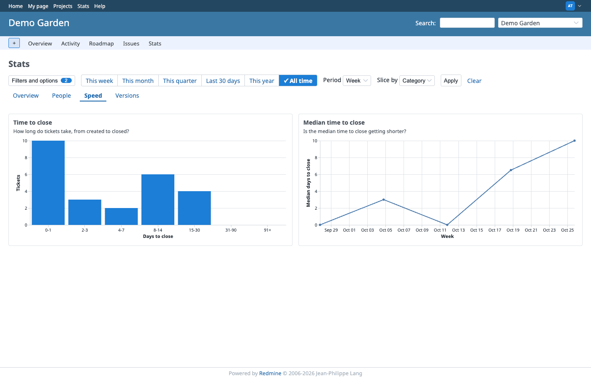
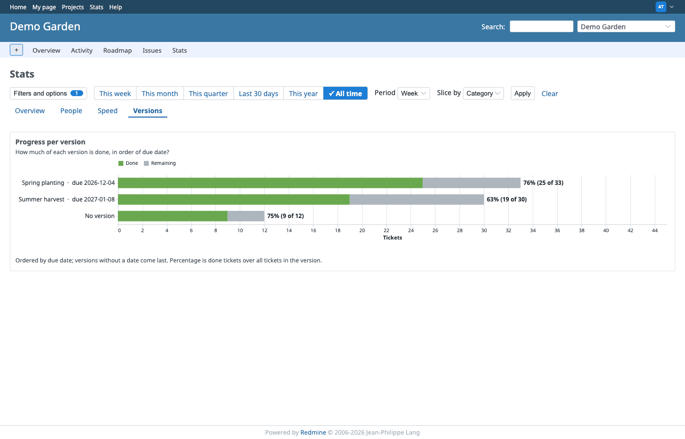
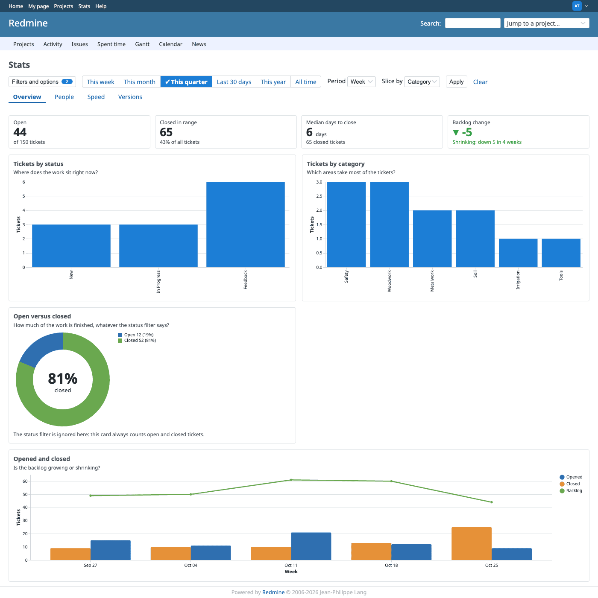

# Rubylode Stats for Redmine

TL;DR: a Stats page for every [Redmine](https://www.redmine.org) project, and one across projects, that answers "what is
getting done" with a few clear charts.

I wanted plain answers in a few seconds: who closed tickets this week, which categories and versions are being worked
on, how many tickets are open and closed, how long closing takes. So the page draws charts over the same filters the
ticket list already has, and every bar links to the matching tickets.

## What it does

The page has tabs, and each tab answers one family of questions. The charts sit in cards on a grid, under a filter bar.

- Overview: four tiles first (open tickets, closed in the range, median days to close, backlog change), then tickets by
  status, tickets by category (or version, assignee, tracker, priority, author), a donut of open against closed, and
  opened and closed per period with the backlog line. The donut ignores the status filter on purpose, so it always
  shows open and closed together.
- People: tickets closed per person per period. The person is the author of the change to a closed status; for tickets
  closed without such a change (an import, say) it is the assignee.
- Speed: how long tickets take to close, as a histogram with the median marked, and the median per period as a line.
- Versions: progress per version, done against remaining, in order of due date. Versions without a date come last, and
  tickets without a version show as "No version".

How you narrow it:

- Redmine's own ticket filters, and saved queries as reports. Every chart counts exactly what the ticket list shows
  for the same filters.
- One row of presets: This week, This month, This quarter, Last 30 days, This year, All time. They set the date that
  suits the chart (closed on for finished work, created on for intake). The first time you open a tab it shows this
  quarter; choose All time to see everything, which the Versions tab needs to show every version.
- Filters and options opens Redmine's usual filter form above the charts.
- Two selects: how to slice the data, and how long a period is (day, week, month). Weeks start on Monday, in your time zone.
- A bar or slice, clicked, opens the ticket list with the same filters plus that bar's value. Tooltips show the numbers,
  and a click on the legend hides a series.
- Tickets without a value (no category, no assignee) show as "None", not dropped.
- A ticket that was reopened and closed again counts once, at its latest closing.

Only tickets the user may see are counted.

### Across projects

The Stats link in the top menu opens the same tabs over every project where the user holds the permission and the
module is on. Its links to the ticket list keep to those projects.

## Installation

Redmine 7.0 or newer. The plugin adds no table. The folder must be named `redmine_rubylode_stats`, the same as the plugin id.

1. Put the plugin in your Redmine's `plugins` folder:

       cd /path/to/redmine/plugins
       git clone https://github.com/rubylode/redmine-rubylode-stats.git redmine_rubylode_stats

2. Restart Redmine.

3. Allow it, as an administrator:
   1. Administration, Roles and permissions: tick View stats (`view_rubylode_stats`) for the roles that should see the page.
   2. Each project needs the module once (Settings, Modules). To do all of them at once:

          bundle exec rails runner -e production 'Project.find_each { |project| project.enable_module!(:rubylode_stats) }'

4. Open a project. A Stats tab now sits after Issues, and a Stats link in the top menu opens the page across projects.

To upgrade, `git pull` and restart. To remove it, delete the folder and restart. Tickets are not touched.

## Try it

A throwaway Redmine 7 runs from this folder, with the repository mounted as the plugin. It needs [Docker](https://www.docker.com).

    docker compose up -d
    open http://localhost:3008

Give it a minute to start. Then fill it with two demo projects (Demo Garden and Demo Workshop), four people and about 150
tickets over the last 12 weeks, some of them reopened, some without a category or an assignee:

    docker exec redmine-stats-dev bundle exec rails runner plugins/redmine_rubylode_stats/script/seed_demo.rb

The demo people are Alan Turing, Ada Lovelace, Grace Hopper and Edsger Dijkstra. Sign in as one of them:

| Login             | Password        |
| ----------------- | --------------- |
| `alan.turing`     | `demo-password-1` |
| `ada.lovelace`    | `demo-password-1` |
| `grace.hopper`    | `demo-password-1` |
| `edsger.dijkstra` | `demo-password-1` |

The administrator is `admin` with the password `admin` (the script sets it, for this preview only). Open Demo Garden and
click Stats. The script is safe to run twice. Wipe the preview with `docker compose down -v`.

## Tests

    bin/test                                       all tests
    bin/test test/unit/issue_list_link_test.rb     one file

They run in a Redmine 7 image with its test gems. The numbers behind the charts are tested first; a chart is checked by the
data it carries, not by how it looks.

## License

GNU General Public License, version 2 or (at your option) any later version, the same as Redmine. See `LICENSE`.

Copyright (C) 2026 Nick Gorbikoff.
